# Example games

These games ship with the engine. Each exercises a different part of it. Sources are under [`examples/src/`](https://github.com/mert574/m2d-engine/tree/master/examples/src) and [Adding a demo](../contributing/adding-a-demo) explains how they are wired.

<a class="example-card" target="_self" href="https://mert574.github.io/m2d-engine/examples/yard/">

3D · WebGPU
<strong>The Yard</strong>
The first three-dimensional scene: a walled yard of crates, spheres, barrels and a glTF milk truck under a low sun, with soft shadows, a mirror sphere reflecting the sky, lamps and a floodlight that glow and light the yard, a dusk to turn on, and the Khronos fox to walk and run through it. Drag to orbit, WASD to walk. Chromium only.

</a>

<a class="example-card" target="_self" href="https://mert574.github.io/m2d-engine/examples/showcase/">
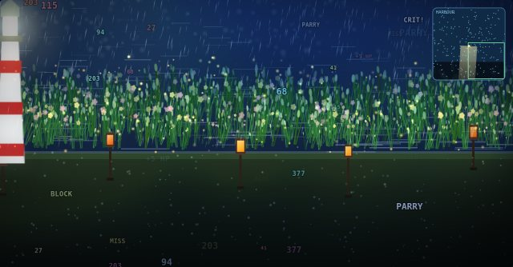

renderer
<strong>Renderer showcase</strong>
A harbour at night with thousands of sprites, particles, lights and a full post stack, counted on screen. Swap backends and compare.

</a>

<a class="example-card" target="_self" href="https://mert574.github.io/m2d-engine/examples/platformer/">
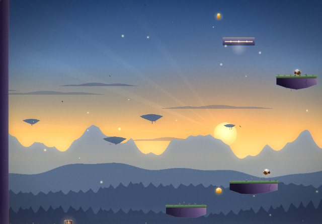

physics · scenes
<strong>Platformer</strong>
Side-scrolling level with moving platforms, a chasing enemy, coins and a level-complete trigger.

</a>

<a class="example-card" target="_self" href="https://mert574.github.io/m2d-engine/examples/maze/">
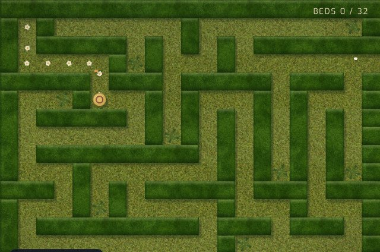

rooms camera · character
<strong>Hedgerow Court</strong>
A hedge-maze garden of single-screen courts. The camera holds each court and glides to the next at the gate; daisies bloom where you have walked.

</a>

<a class="example-card" target="_self" href="https://mert574.github.io/m2d-engine/examples/scroller/">
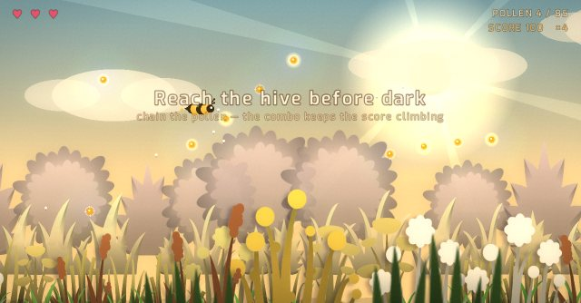

scroll camera · parallax
<strong>Beeline</strong>
An auto-scroller into the dusk: chain pollen into combos, dash past wasps and out of orb webs, and reach the hive before dark on three wing hearts.

</a>

<a class="example-card" target="_self" href="https://mert574.github.io/m2d-engine/examples/physics/">
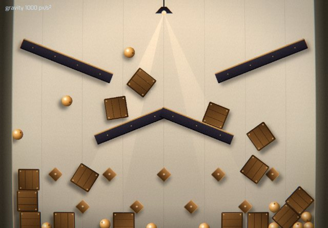

input · physics
<strong>Physics playground</strong>
Grab and throw bodies through a funnel, a splitter and a peg field. Arrow keys change gravity.

</a>

<a class="example-card" target="_self" href="https://mert574.github.io/m2d-engine/examples/topdown/">
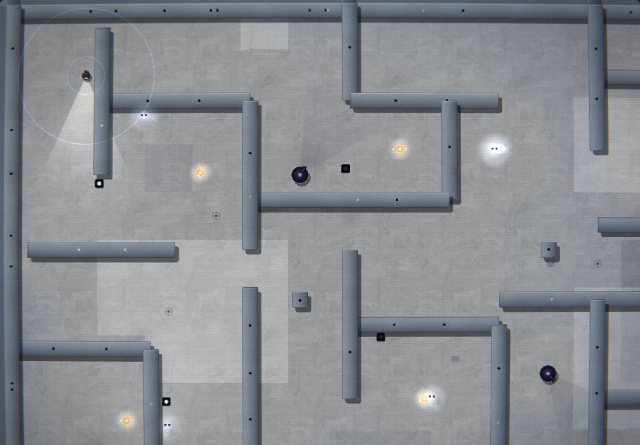

actors
<strong>Top-down game</strong>
Eight-directional movement, ghosts that chase, turrets with line of sight and rockets.

</a>

<a class="example-card" target="_self" href="https://mert574.github.io/m2d-engine/examples/oblique/">
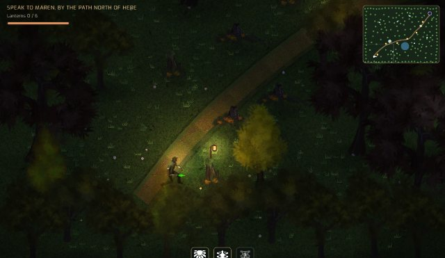

perspective · depth sort
<strong>Hollow Grove</strong>
A three-quarter view of a grove at dusk, with a small quest: talk to Maren and Oswin, learn the ward, light the lanterns and open the clearing.

</a>

<a class="example-card" target="_self" href="https://mert574.github.io/m2d-engine/examples/iso/">
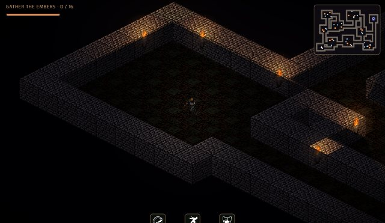

isometric · click to move
<strong>Cinder Keep</strong>
An isometric dungeon: click or walk the knight through torchlit halls, gather the embers past the keep's dead and open the stair.

</a>

<a class="example-card" target="_self" href="https://mert574.github.io/m2d-engine/examples/belt/">
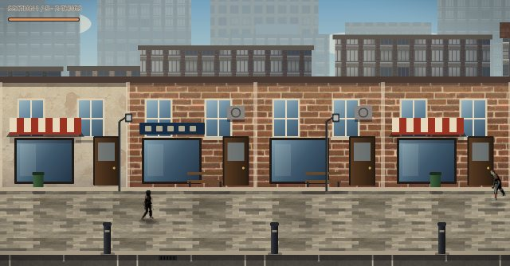

belt scroller · waves
<strong>Ash Row</strong>
A beat 'em up down a sunlit street with a skyline behind it: chain punches, sweep kicks and drop kicks through five sections of thugs to reach the door.

</a>

<a class="example-card" target="_self" href="https://mert574.github.io/m2d-engine/examples/drift/">
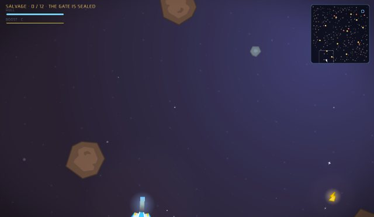

rotating camera · parallax
<strong>Salvage Run</strong>
Fly a salvage ship through an asteroid field with the view turning to keep your nose up. Shoot meteors apart, outrun drones, bring twelve pods to the gate.

</a>

<a class="example-card" target="_self" href="https://mert574.github.io/m2d-engine/examples/circuit/">
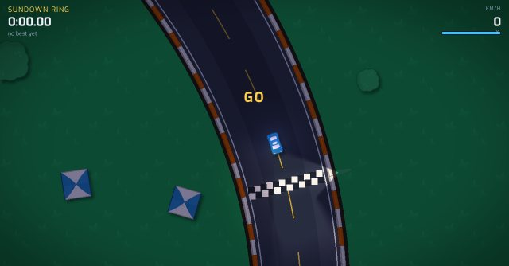

ticks · replay · lights
<strong>Night Circuit</strong>
Arcade time trials on five circuits. Drift, boost, spill oil for the next round, race your ghost and replay laps from recorded inputs.

</a>

Each example opens on a main menu with a scene of its own behind the type, drawn in code through `UIBackdrop` layers, and plays its own pair of tracks from the IDMf netlabel ([credits](./music-credits)). Every example mounts the settings menu, opened with O. Its renderer row reloads the page with `?renderer=canvas` or `?renderer=webgl`, and the same parameter can be typed into the URL. The showcase skips its menu when the parameter is present.

No example locks the pointer; they all leave it free. It is off by default, and a game that wants it asks for it (see [Pointer lock](../guide/input#pointer-lock)).

## Controls

### The Yard

The engine's first 3D scene, on the WebGPU renderer. The yard is primitive shapes from the scene file's `mesh` blocks, plus one glTF model, the Cesium milk truck. Needs a Chromium browser. Add `?scene=lot` for the lot, the renderer's tech demo built as a place: the corner of a small town where Main Road crosses Station Road, on a late afternoon. The fox starts outside the grocer on the corner, where the milk truck is delivering and its crates (the yard's, which the fox can knock over) are stacked on the pavement; beside it a shuttered shop and a café with tables out, and a car park behind. Across Station Road a terrace of seven houses faces Main Road over front gardens, with a gazing globe mirroring the street in one, and each back garden is somebody's: a vegetable plot, a patio, a gnome garden, one gone to seed. Across Main Road a works depot holds a warehouse with roller doors and a loading dock, an office, an open workshop, containers and stock in barriered bays; across both roads a park with a jacaranda avenue up to a cobbled plaza with a statue and a coffee cart, and beyond it a sculpture terrace: twenty spheres on plinths, each one material (chrome to cast iron, car paint, varnish, clear, tinted and frosted glass, plastics, neon), behind a glass screen. Beyond are allotments, woodland scattered by noise with a ruined fort down a dirt track, and meadow. Press T for dusk, when the lit windows, door lanterns and street lamps carry the light. Thousands of props draw as resident instances the GPU culls, streaming in as you walk; F3 shows what the frame draws.

| Input | Action |
| --- | --- |
| Drag | Orbit the camera |
| Scroll | Zoom |
| `W` `A` `S` `D` or arrows | Walk the fox, relative to the camera; it runs when it can |
| `Space` | Jump |
| `T` | Afternoon to dusk and back |
| `O` | Settings |
| `F3` | Frame statistics |

### Renderer showcase

[Play](https://mert574.github.io/m2d-engine/examples/showcase/) · [Source](https://github.com/mert574/m2d-engine/tree/master/examples/src/showcase)

A batching stress test and a side-by-side comparison of the two renderer backends. The scene is a harbour at night. It has thousands of batched sprites, a reed bank with per-sprite tint, a text storm, a flock playing an animated sheet across three bands of parallax, and a lighthouse beam built from nested clips. Rain is a packed particle buffer, the lanterns are lights with bloom and a chart nests clips in screen space. The engine's own backdrop sits behind it all — a sky, seeded star and cloud layers at their own parallax, and fireflies and sparks as 2D particle fields.

Over that steady load runs a programme of beats on a 28-second loop: a knock that shakes the camera and splits the colour, a zoom in, a stretch of slow motion that blurs the frame, and a roll. The light turns from dusk through night to first light on its own cycle, and the post stack — bloom, vignette, colour grade, chromatic aberration and blur — moves with it. The lighthouse beam is a shadowed spot light, so the lantern posts throw shadows that swing as it sweeps. The overlay names the beat and the hour, which is what lets two backends be compared at the same moment of the programme.

The overlay reports frames per second, primitives, draw calls and state changes. It also lists the optional capabilities the active backend supports. On WebGL2 the scene collapses into a handful of draw calls. On Canvas each primitive is one call, and tint, particles, lights and post effects drop out.

The scene is deterministic. Layers are built from a seeded random generator, the camera pans a fixed path, and the programme runs on the wall clock — so both backends run the same workload and reach the same beat at the same time. A beat only ever sets camera or renderer state; none of them changes how many primitives a layer draws.

| Key | Action |
| --- | --- |
| `[` and `]` | Decrease and increase load |
| `1` to `9` | Toggle layers: drift, reeds, labels, flock, chart, rain, lights, post, beats |
| `P` | Pause the camera pan |
| `H` | Hide the overlay |

### Platformer

[Play](https://mert574.github.io/m2d-engine/examples/platformer/) · [Source](https://github.com/mert574/m2d-engine/tree/master/examples/src/platformer)

A side-scrolling level with a dynamic-body player, moving platforms, a chasing enemy, coins and a level-complete trigger, set in the dusk valley its menu shows: a parallax skyline behind the level, drawn terrain, lights and bloom over it. The built-in `Player`, `Bee`, `Platform`, `MovingPlatform`, `Coin` and `Trigger` actors are subclassed for the look only; scene JSON files, sprite sheets and the music that changes between the menu and the level work as stock.

| Key | Action |
| --- | --- |
| Arrow keys | Move |
| `Space` | Jump |
| `X` | Attack |

### Hedgerow Court

[Play](https://mert574.github.io/m2d-engine/examples/maze/) · [Source](https://github.com/mert574/m2d-engine/tree/master/examples/src/maze)

The single-screen, room-based perspective: a hedge-maze garden in three maps, each a grid of walled courts, and each court exactly one screen. The camera's `rooms` mode holds the court the gardener stands in and glides through the hedge when they take a gate, the classic room transition. Movement is the engine's `GlideControl`: tap a direction and the gardener keeps walking, the same key stops them, and a turn pressed a beat early or late is buffered and taken at the junction. Every court is its own seeded maze, connected along a spanning tree with a loop or two, carved once into a scene file the editor opens, and a test pins that every map stays solvable. Dead ends are flower beds to tend: walk through one and its buds open, counted on the HUD. Daisies bloom along the walked path, butterflies work the beds, cloud shadows cross the lawn and the travertine fountain at the far end opens the next map. The lawn, hedge and fountain stone are CC0 materials from ambientCG.

| Key | Action |
| --- | --- |
| Arrow keys | Tap to set off; the same key stops, a new one turns |
| `Escape` | Main menu |

### Beeline

[Play](https://mert574.github.io/m2d-engine/examples/scroller/) · [Source](https://github.com/mert574/m2d-engine/tree/master/examples/src/scroller)

The auto-scroller: the camera runs in `scroll` mode down a meadow verge while the sun sets over the length of the lane. The sky, the clouds, the ambient light and the post grade all keep the run's time, from god rays at the gate to fireflies at the hive. The run is paced in five acts: open meadow, a thistle slalom, wasp beats that telegraph with a mark and then dart, a hollow strung with backlit orb webs that hold the bee until a dash tears it free, and a dusk glide home. Pollen chains into a combo that multiplies the score; a sting costs one of three wing hearts and scatters what the bee carries; the hive hands out a rank. The simulation never reads the camera: a `ScrollFront` entity advances at the same speed per fixed tick and enforces the window, the worked example of the [determinism contract](../contributing/determinism). The meadow is six parallax planes of Kenney foliage silhouettes under aerial haze, pre-tinted to the palette at asset time, each plane taking its silhouettes from the scene; the lane itself is a scene file the editor opens, and a test pins every grain inside the flight band, every web passable and each hazard to its act.

| Key | Action |
| --- | --- |
| Arrow keys | Fly |
| `Space` / `X` | Dash: a burst with a moment of grace; it tears webs |
| `Escape` | Main menu |

### Physics playground

[Play](https://mert574.github.io/m2d-engine/examples/physics/) · [Source](https://github.com/mert574/m2d-engine/tree/master/examples/src/physics)

A sandbox with a funnel, a splitter and a peg field made of rotated static boxes, drawn as a lamplit machine: brass pegs, girder rails, amber balls and wooden crates, with no image assets at all. The machine is a scene file the editor opens, and the balls and crates attach the engine's `Grabbable` constraint, which steers a body toward the pointer with velocity so it still collides and can be thrown; whatever the pointer holds glows. Gravity is a counter the scene's action rules turn, and the world's fall follows it.

| Input | Action |
| --- | --- |
| Drag | Grab and throw a body |
| Right-click or long press | Remove a body |
| Click empty space | Drop one at the pointer |
| `Space` | Drop one into the funnel |
| `↑` / `↓` | Lighter and heavier gravity |
| `G` | Back to earth gravity |
| `Escape` | Main menu |

### Top-down game

[Play](https://mert574.github.io/m2d-engine/examples/topdown/) · [Source](https://github.com/mert574/m2d-engine/tree/master/examples/src/topdown)

Eight-directional movement with zero gravity, ghosts that chase, turrets that check line of sight before firing, pickups and an exit trigger, staged as the dark facility the menu's motion tracker is scanning: concrete and steel under failing ceiling lamps, a hand lamp and a sonar ping on the player, drawn apparitions for ghosts, and each turret showing its scan cone, pale while patrolling, red and narrow when it has line of sight. Taking a hit tears the picture for a moment.

| Key | Action |
| --- | --- |
| Arrow keys | Move |
| `X` | Attack |

### Hollow Grove

[Play](https://mert574.github.io/m2d-engine/examples/oblique/) · [Source](https://github.com/mert574/m2d-engine/tree/master/examples/src/oblique)

The engine's 3/4 ("oblique") perspective, in a grove at dusk, with a small quest in it. The trees are painted sprites standing on trunk-sized footprints, so the walker passes behind a canopy the moment their feet are above its roots; the people are eight-direction pre-rendered sheets whose facing follows the heading; the ground is a photographed grass texture with a dirt path laid along a curve, and grass and flowers that move in the wind. Footsteps follow the stride, and the swing reaches in whatever direction you last moved. Space hops through `elevation`: the sprite lifts and its shadow pulls in while the collider stays on the ground. Lanterns are lights that throw real shadows from the trunks on WebGL, and the wheel zooms the camera.

Maren the herbalist sends you east past the pond to Oswin the lamplighter, who teaches the ward that opens the sealed clearing in the north-east. Two of three skills are yours from the start: a lantern flare that throws the wisps back, and a blink through the dark. The minimap marks whoever you should talk to next.

| Key | Action |
| --- | --- |
| Arrow keys | Move |
| `Space` | Hop |
| `X` | Swing |
| `E` | Talk, and advance a conversation |
| `1` `2` `3` | Flare, Blink, Ward (Oswin teaches the ward) |
| Wheel | Zoom |
| `Escape` | Back to the menu |

### Cinder Keep

[Play](https://mert574.github.io/m2d-engine/examples/iso/) · [Source](https://github.com/mert574/m2d-engine/tree/master/examples/src/iso)

The engine's isometric perspective. The scene declares `world.projection`, and every position is drawn through it while physics, movement and the depth sort stay on the flat ground plane. The floor is a diamond tile layer over only the carved cells, the walls are block sprites on tile footprints that fade when the knight passes behind them and cast torchlight shadows from their projected diamonds, and the knight and the keep's dead are Flare's eight-facing isometric figures. Click the floor to walk there, or use the arrows along the screen's axes; either way the pace is steady on screen. Three abilities: a cleave all around, a dash along the heading and a shield of circling embers. Gather the embers to open the stair past the keep's dead.

| Key | Action |
| --- | --- |
| Click | Walk there |
| Arrow keys | Move along the screen |
| `X` | Swing, in the direction last faced |
| `1` `2` `3` | Cleave, Dash, Ember Shield |
| Wheel | Zoom |
| `Escape` | Back to the menu |

### Ash Row

[Play](https://mert574.github.io/m2d-engine/examples/belt/) · [Source](https://github.com/mert574/m2d-engine/tree/master/examples/src/belt)

The engine's belt scroller and its 2.5D street, at noon. Five planes give the row depth: a hazy skyline at a tenth of the camera's travel, taller blocks behind the row at half, the shopfronts and their kerb props on the play plane, the road below the gutter, and bollards in front that outrun the pavement. The scene declares a `belt` projection, so the street's depth lane is compressed on screen while movement, chasing and the depth sort run on the flat ground. Space jumps through `elevation`, with the engine's ground shadow staying on the paving as the rogue rises. X chains a three-punch combo whose finisher launches whoever it lands on, C sweeps the whole crowd back on its own cooldown and a strike in the air is a heavy drop kick, all on the engine's `Attack` combo support. The camera follows only along the street and locks at each section until its wave of Flare's zombies, goblins and skeletons is down; then the GO sign flashes and the lock lifts. The paving and brick are ambientCG materials under a blue sky.

| Key | Action |
| --- | --- |
| Arrow keys | Move along the street and the lane |
| `Space` | Jump |
| `X` | Punch; chained presses jab, cross, launch |
| `C` | Sweep kick, all the way around |
| `X` in the air | Drop kick |
| `Escape` | Back to the menu |

### Salvage Run

[Play](https://mert574.github.io/m2d-engine/examples/drift/) · [Source](https://github.com/mert574/m2d-engine/tree/master/examples/src/drift)

The rotating top-down perspective. The camera's `followRotation` keeps the ship's nose up the screen and eases out as it picks up speed, so the asteroid field wheels around you. A far star tile at a tenth of the camera's travel, nebulae and a scatter of star sprites at their own depths give the void distance. Meteors are dynamic bodies that split big to medium to small when shot and cost hull when rammed; drones hunt, turn to face you and fire; twelve salvage pods open the jump gate. Every sprite and sound is Kenney's Space Shooter Redux.

| Key | Action |
| --- | --- |
| Left, Right | Turn |
| Up | Thrust |
| Down | Brake, reverse |
| `X` | Fire |
| `C` | Boost |
| `Escape` | Back to the menu |

### Night Circuit

[Play](https://mert574.github.io/m2d-engine/examples/circuit/) · [Source](https://github.com/mert574/m2d-engine/tree/master/examples/src/circuit)

Arcade time trials at night on five circuits of rising difficulty: wider or narrower roads, sliding gates, patrolling traffic, cone rows and oil barrels that spill onto the racing line when hit. The spill stays for every following round of the session, where the hit's angle put it. Laps are timed in simulation ticks. The best lap of each circuit is stored as its input recording: Enter replays it through the engine's input seam and reports whether the re-simulation matched the recording; it always does, which is the point. The best lap also runs alongside as a ghost. Headlights and street lamps are spot lights with shadow casting, so barriers, barrels and trees throw moving shadows as you pass; on the Canvas backend the same game runs in daylight. Each circuit is a scene file the editor opens: its road is a closed smooth path whose points carry the width of the asphalt, and the surface, the kerbs and the barriers are all resampled from it, so moving a point moves the circuit.

| Key | Action |
| --- | --- |
| Arrow keys | Throttle, brake and steer |
| `Space` | Handbrake; hold to drift |
| `X` | Nitro |
| `R` | Restart the round (fresh props, the session's oil stays) |
| `Enter` | Replay the best lap, or the round so far |
| `Escape` | Back to the menu |
